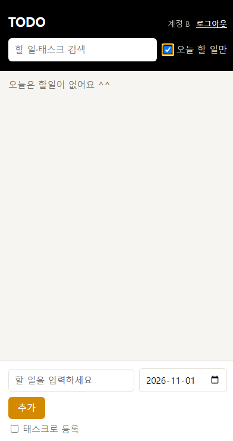
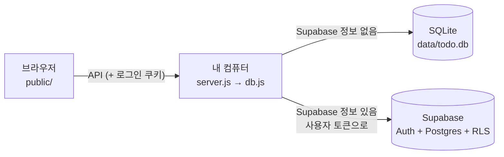
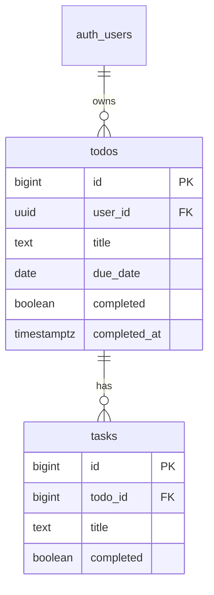

# TODO

큰 할 일(Todo) 아래에 하위 태스크(Task)를 두고 하나씩 체크하는 Todo 앱.
데이터는 DB에 저장되어 껐다 켜도 남는다. DB는 두 가지 중 `.env` 설정으로 고른다.

| 모드 | 언제 | 저장 위치 | 로그인 |
|---|---|---|---|
| **SQLite** (길 A) | `.env`에 Supabase 정보가 **없으면** | 내 컴퓨터 `data/todo.db` | 없음 (혼자 쓰기) |
| **Supabase** (길 B) | `.env`에 Supabase 정보가 **있으면** | 클라우드 Postgres | 이메일 회원가입·로그인, 내 할 일만 보기(RLS) |

- **운영 서버 (Render):** https://todo-0vru.onrender.com/ (Supabase 모드. 회원가입·로그인 후 내 할 일만 보인다. 무료 서버라 한동안 안 쓰면 첫 접속이 30초~1분 걸린다)
- **데모:** https://eple-lab.github.io/todo/ (서버 없이 브라우저에서만 동작, 새로고침하면 초기화)
- **기획서:** [docs/PRD.md](docs/PRD.md)
- **저장·보안 확인 기록:** [docs/verification.md](docs/verification.md)
- **문서 전체:** [docs/](docs/README.md)

## 화면


- 위쪽: 검색창(할 일·태스크 제목), "오늘 할 일만" 보기. Supabase 모드에서는 로그인한 이메일과 로그아웃
- 가운데: 할 일과 하위 태스크. 진행률(2/4), 마감일, 완료한 할 일의 자동 삭제 날짜가 오른쪽에 표시된다. 오늘 마감인 할 일은 노란 배경
- 아래쪽: 할 일 등록(마감일 기본값 오늘). "태스크로 등록"을 체크하면 넣을 할 일을 고른다



## 주요 기능

- (Supabase 모드) 이메일 회원가입·로그인 (Supabase Auth), **내 할 일만 보기** (RLS)
- 할 일 추가·완료·삭제, 하위 태스크 추가·완료·삭제
- 안 끝난 태스크가 있는 할 일을 완료하거나, 태스크가 있는 할 일을 지울 때 확인
- 할 일·태스크 제목 검색, 오늘 할 일만 보기. 검색어 없이 "오늘 할 일만"을 켰는데 오늘 마감인 할 일이 없으면 "**오늘은 할일이 없어요 ^^**"라고 알려 준다
- 마감일 필수(기본값 오늘, 지난 날짜 금지), 중복 제목 금지
- 완료 후 90일 지나면 자동 삭제

규칙 전체는 [docs/business-rules.md](docs/business-rules.md).

## 실행 방법

필요한 것: Node.js 24 이상

### SQLite 모드 (가장 간단)
`.env` 없이 바로 실행한다.
```bash
npm install
npm start
```
http://localhost:3000 → 바로 사용. 데이터는 `data/todo.db` 파일에 저장된다.

### Supabase 모드
추가로 필요한 것: Supabase 무료 프로젝트

1. Supabase 프로젝트를 만들고 [db/supabase/01_schema.sql](db/supabase/01_schema.sql)을 SQL Editor에서 실행한다.
2. `.env.example`을 `.env`로 복사하고 `SUPABASE_URL`, `SUPABASE_PUBLISHABLE_KEY`를 채운다.
   Connect 화면에 `NEXT_PUBLIC_SUPABASE_URL`처럼 나오면 앞의 `NEXT_PUBLIC_`만 빼고 넣는다.
3. `npm start` → http://localhost:3000 → 회원가입 → 사용

### 테스트
```bash
npm test
```
기본 기능 14가지(CRUD, 규칙, 재시작 후 유지, 90일 자동 삭제)를 임시 DB로 자동 확인한다. 화면 상태 테스트와 RLS 확인 방법은 [docs/testing.md](docs/testing.md).

### 모드 바꾸기
`.env`의 `SUPABASE_URL`, `SUPABASE_PUBLISHABLE_KEY`를 **둘 다 비우면 SQLite**, **둘 다 채우면 Supabase**. 서버를 다시 켜면 바뀐다.
서버 첫 줄에 지금 모드가 나온다.
```
TODO: http://localhost:3000 (SQLite: data/todo.db)
TODO: http://localhost:3000 (Supabase)
```
하나만 채우면 설정 실수로 보고 서버가 켜지지 않는다. 두 모드의 데이터는 서로 옮겨지지 않는다.

단계별 설명은 [docs/supabase-setup.md](docs/supabase-setup.md), 백업·문제 해결은 [docs/operations.md](docs/operations.md).

### 배포 (Render)
운영 서버 설정은 [render.yaml](render.yaml)(Render Blueprint)에 코드로 둔다. Free 플랜, Singapore 리전, `npm start`, 헬스 체크 `/`, `NODE_ENV=production`.

1. Render → **New → Blueprint** → 저장소 `eple-lab/todo` 연결
2. `SUPABASE_URL`, `SUPABASE_PUBLISHABLE_KEY` 값 입력 (`render.yaml`에는 키 이름만 있고 값은 Render에만 저장된다)
3. **Deploy Blueprint** → 로그에 `(Supabase)`가 찍히면 성공. 이후 `main`에 push하면 자동 재배포

배포 결과: https://todo-0vru.onrender.com/


자세한 설정과 이유는 [docs/deployment.md](docs/deployment.md).

## 구조



화면은 백엔드에만 요청하고, Supabase 주소와 키는 서버의 `.env`에만 있다.

```
server.js              백엔드: API 창구, 로그인(Supabase 모드), 규칙 검사
db.js                  DB 입구: .env를 보고 SQLite 또는 Supabase 쪽을 고른다
db/sqlite.js           SQLite 모드 DB 코드  (표 정의: db/schema.sql)
db/supabase.js         Supabase 모드 DB 코드 (함수 이름·인자는 sqlite.js와 같다)
supabase.js            요청마다 그 사용자로 Supabase에 접속 (httpOnly 쿠키)
db/supabase/           표·RLS·함수 SQL (Supabase SQL Editor에서 실행)
public/                화면(프론트): 백엔드 API에만 요청한다
public/demo-api.js     GitHub Pages 데모용 가짜 백엔드
scripts/rls-check.mjs  계정 두 개로 RLS 확인 (npm run check:rls)
docs/                  기획서와 문서, 화면 캡처
.github/workflows/     push하면 public/을 GitHub Pages에 올리는 설정
render.yaml            Render 운영 서버 설정 (Blueprint). 비밀값은 키 이름만
```

자세한 구조는 [docs/architecture.md](docs/architecture.md).

## DB 구조

표 2개, **todos 1 : N tasks**. 아래는 Supabase 모드 기준이고, 할 일마다 주인(`user_id`)이 있어 RLS로 자기 행만 다룬다.
SQLite 모드는 같은 모양에서 `user_id`만 없다 ([db/schema.sql](db/schema.sql)).



열 설명, 제약조건, RLS 정책, 색인은 [docs/database.md](docs/database.md). API는 [docs/api.md](docs/api.md).

## 문서

| 문서 | 내용 |
|---|---|
| [PRD](docs/PRD.md) | 만들 기능과 조건 |
| [확인 기록](docs/verification.md) | 로컬·클라우드 저장, RLS 확인 결과 (과제용) |
| [Supabase 연결](docs/supabase-setup.md) | 프로젝트 만들기부터 RLS 확인까지 |
| [규칙](docs/business-rules.md) | 앱이 지키는 규칙, 어디서 막는지 |
| [구조](docs/architecture.md) | 파일별 역할, 로그인·요청 흐름 |
| [데이터베이스](docs/database.md) | 표·열·제약·RLS·색인 |
| [API](docs/api.md) | 주소, 요청·응답 예시 |
| [보안](docs/security.md) | RLS, 쿠키, SQL 주입, XSS, 키 관리 |
| [운영](docs/operations.md) | 실행, 백업과 복구, 문제 해결 |
| [테스트](docs/testing.md) | 체크리스트, 테스트 기록 |
| [테스트 결과 2026-10-31](docs/test-report-2026-10-31.md) | 통합·Render 배포 후 테스트 케이스와 결과 |
| [버그 수정 기록](docs/bugfix.md) | 버그별 원인·수정·확인 |
| [배포](docs/deployment.md) | GitHub Pages 데모, Render 배포 준비물 |
| [결정 기록](docs/decisions.md) | 왜 이렇게 만들었는지 |
| [로드맵](docs/roadmap.md) | 진행 기록, 과제 대응 |
| [회고](docs/retrospective.md) | 강의 회고 노트 |

## 진행 기록

- [x] 길 A: 로컬 SQLite로 구현 (`path-a` 태그)
- [x] 길 B: Supabase로 저장소 전환 + 로그인 + RLS (코드 완료)
- [x] 길 A·B 합치기: `.env` 설정에 따라 SQLite / Supabase 중 하나로 동작
- [x] 길 B: 실제 Supabase 프로젝트에서 저장·RLS 확인 (`npm run check:rls` 19/19, [확인 기록](docs/verification.md))
- [x] 길 C(선택): Render 배포 (https://todo-0vru.onrender.com/)

자세한 내용은 [docs/roadmap.md](docs/roadmap.md).
